# Explainstone and Songmelyn · 讲解石与颂美铃

[](https://github.com/3L96WW1/explainstone-and-songmelyn/actions/workflows/build.yml)
[](LICENSE)


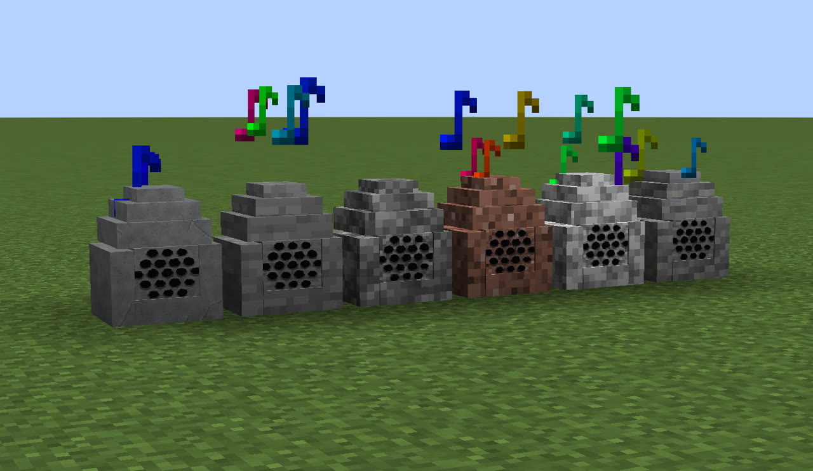

### English summary

**Explainstone and Songmelyn** adds stone speakers to Minecraft 1.21.1 (Fabric) that play **Ogg Vorbis** music —
either imported by you (stored in the world, shared with other players) or streamed from a broadcast transmitter.

- 6 Explainstone variants (rock / stone / cobblestone / granite / diorite / andesite) + wall-mounted **Songmelyn**
- Right-click GUI: playlist (with track duration + progress bar), play/stop, play mode (sequence / repeat one / shuffle), redstone toggle, per-block volume and range sliders
- **Local mode** plays its own playlist, **Receive mode** listens to a channel (`350.000`–`350.999`)
- **Broadcast Transmitter** sends music on a channel within 32–512 blocks (adjustable), with timer and redstone control
- Independent volume via the vanilla **Records** sound slider
- Requires Fabric Loader ≥ 0.20.1 + Fabric API, Java 21


Minecraft **1.21.1** / Fabric 模组：伪装成石头的音响，可以播放自带或你自己导入的 ogg 音乐，
支持红石触发、频道广播（512 格信号）、收音、进度同步。

作者：**GINKA_3L96WW1**

模组 id：`explainstone`（为兼容存档保持不变）

---

## 截图 / Screenshots

| 添加了六种讲解石 | 颂美铃（壁挂式教室广播音响） |
|---|---|
| 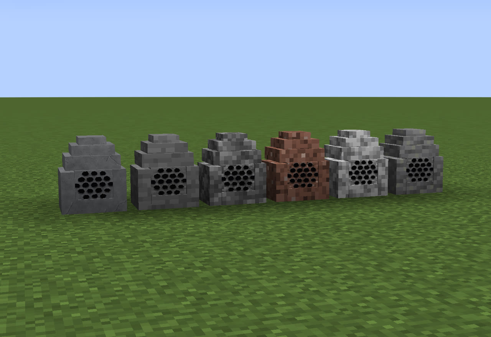 | 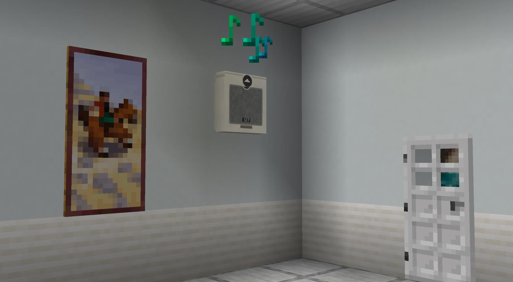 |
| **广播发信器** | **默认纹理的讲解石** |
| 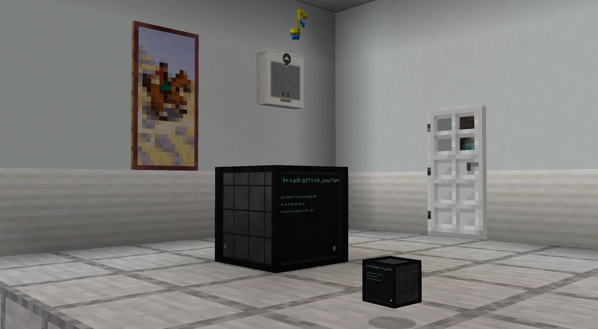 | 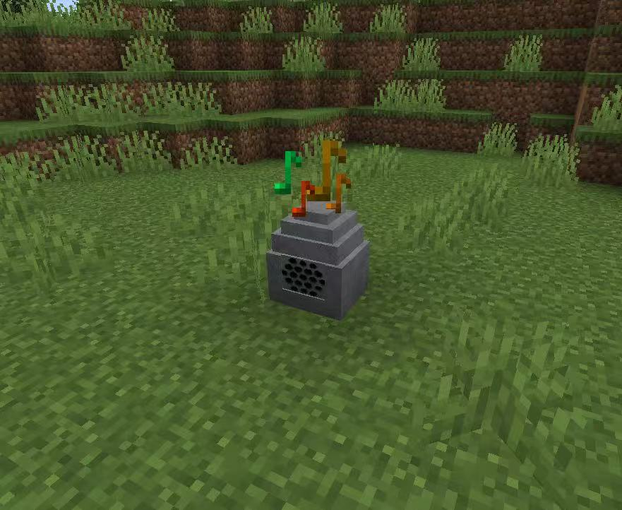 |

## 功能

- **讲解石**（灰色岩石 / 石头 / 圆石 / 花岗岩 / 闪长岩 / 安山岩 共 6 种外壳）+ **颂美铃**（壁挂式教室广播音响，薄板碰撞箱）
  - 右键打开界面：播放列表、播放/停止、播放模式（顺序 / 单曲 / 随机）、红石检测开关、本机放音开关、距离与音量滑块
  - **自播放模式**：放自己的列表
  - **收信模式**：只听频道广播，界面只留频率窗口（`350.000` ~ `350.999`）
  - 播放时方块上方会冒音符粒子；列表显示时长，下方有实时进度条
- **广播发信器**：选择音乐 → 设频率 → 播放，把音乐以该频道广播出去
  - 自己**不发声**，只发信；信号默认传 **512 格**（可调 32~512）
  - 支持定时播放（关 / 1 / 3 / 10 分）与红石控制
  - 收信方的解说石会按发信器的播放模式续播，多台之间进度对齐
- 音频：MC 声音设置里的 **「唱片机（Records）」滑块** 独立控制所有讲解石音量，另有每方块自己的音量百分比
- 导入音频：随时导入任意 **.ogg**（导入后存进**存档**，多人可共享，缺文件会自动下载）

## 安装

1. 安装 [Fabric Loader](https://fabricmc.net/use/) ≥ 0.20.1，Minecraft **1.21.1**，Java 21
2. 把 [Fabric API](https://modrinth.com/mod/fabric-api) 和本模组的 jar 一起放进 `mods/`

## 使用

1. 放一个讲解石 / 颂美铃 / 广播发信器，**右键**打开界面
2. 点「导入 ogg…」选文件（也可以把 ogg 丢进 `config/explainstone/inbox/` 再点一次导入）
3. 选中曲目 → `▶ 播放`；想让它收听广播就切到「收信」并设置频率
4. 发信器上设同频率 → `▶ 播放`，512 格内的收信讲解石就会同步播放

### 导入音频的要求

- 格式：**Ogg Vorbis（.ogg）**，不支持 mp3（可先用 ffmpeg 转：`ffmpeg -i in.mp3 -c:a libvorbis -q:a 5 -ac 1 out.ogg`）
- 建议 **单声道 44.1kHz**（3D 定位需要单声道）
- 单文件上限 **6MB**、时长上限 **5 分钟**（超过会被拒绝并提示）
- 导入的音频保存在 `<存档>/explainstone/audio/`，会把存档撑大，删存档时一起删除

## 合成配方 / Crafting

六种讲解石和颂美铃**共用同一个形状**，只是外壳材料 `M` 不同：

```
 · M ·
 M N M
 M O M
```

- `N` = **音符盒**，`O` = **侦测器**，`M` = 外壳材料（见下表）
- 广播发信器是**另一套形状**：`T A T` / `I O I` / `R C I`
  （`T` 红石火把、`A` 紫水晶碎片、`I` 铁锭、`O` 侦测器、`R` 红石粉、`C` 红石比较器）

| 方块 | 材料 M | 配方预览 |
|---|---|---|
| 讲解石 | **铁锭** | 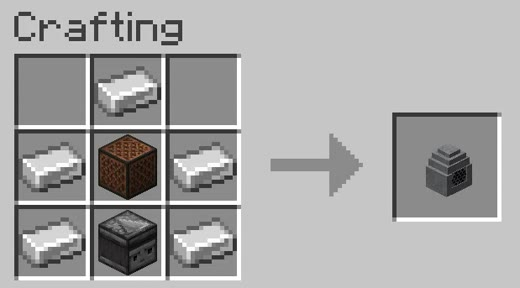 |
| 石头讲解石 | 石头 |  |
| 圆石讲解石 | 圆石 | 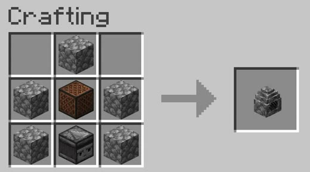 |
| 花岗岩讲解石 | 花岗岩 | 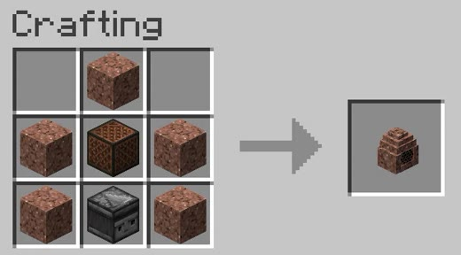 |
| 闪长岩讲解石 | 闪长岩 | 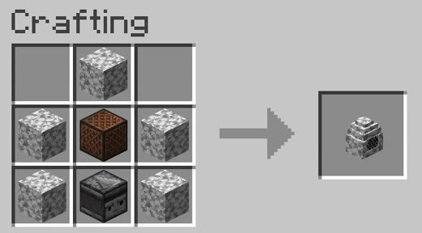 |
| 安山岩讲解石 | 安山岩 |  |
| 颂美铃 | **白色羊毛** | 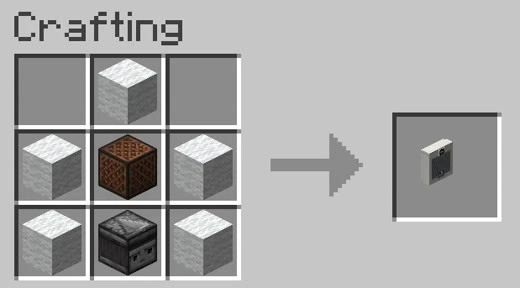 |
| 广播发信器 | 见上面的特殊形状 | 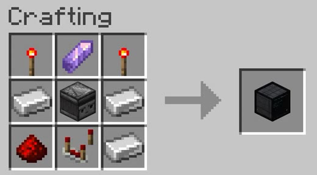 |

## 已知限制

- 只支持 Minecraft **1.21.1**
- 只支持 `.ogg`，不支持 mp3 / m4a / flac
- 多人环境下"跨玩家"的进度基准是各自收到广播的时刻，会差一个网络延迟；**随机模式**各端独立随机
- 播放列表存在方块实体里，**打掉方块配置会丢失**（用带 NBT 的搬运工具可以带走）
- 剪贴板/文件选择框依赖 AWT，无图形环境时请用 `config/explainstone/inbox/` 方式导入

## 版权 / 许可

- **代码**：Mozilla Public License 2.0（见 `LICENSE`）—— 你可以自由使用、修改、随整合包分发；修改过的**本模组源文件**需要继续以 MPL-2.0 开源。
- **素材**（贴图、图标、内置代码生成的音频等）：© GINKA_3L96WW1，保留所有权利；仅允许随本模组原样分发，禁止单独提取用于其他作品。
  - 说明：石头 / 圆石 / 花岗岩 / 闪长岩 / 安山岩变体的**网罩正面贴图**基于 Minecraft 原版材质制作，仅在本模组内使用；Minecraft 及其材质版权归 Mojang / Microsoft 所有。
- 玩家自行导入的音频归上传者所有，本模组不附带任何第三方音乐。
- 本项目与 Mojang / Microsoft 无关联。

## 开发

贴图与模型由脚本程序化生成，可重跑：

```bash
python3 tools/gen_speaker_textures.py   # 全部贴图
python3 tools/gen_speaker_model.py      # 方块模型 / 方块状态 / 物品模型 + 预览
```

预览图输出在 `build/preview/`。
